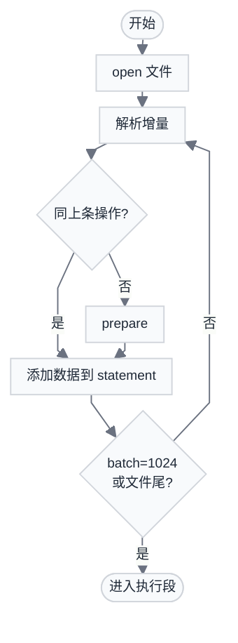
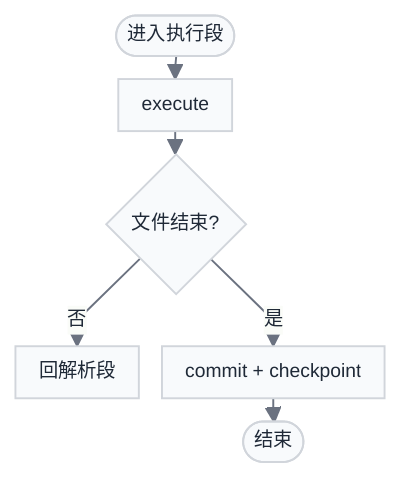
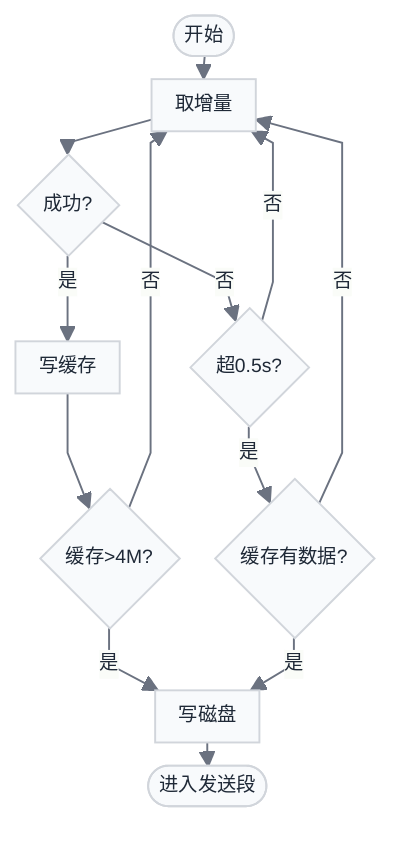
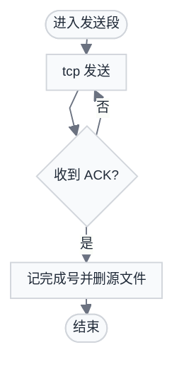
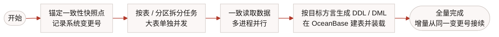
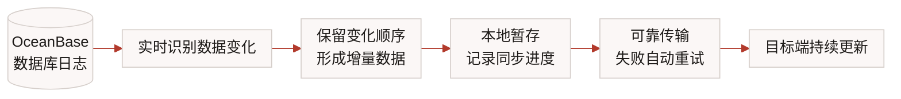
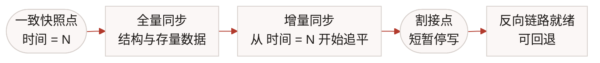
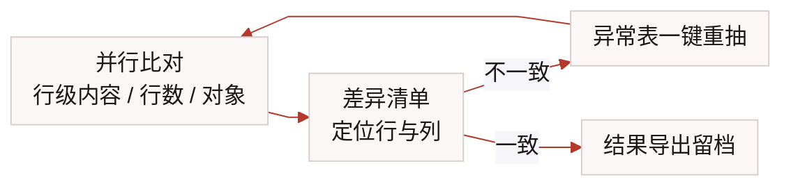

  

    
    

    
数据库同步专家

  

  

    
九桥同步（FZS）· 数据库实时复制平台

    <h1 style="font-size: 2.4rem; font-weight: 700; color: var(--ink); line-height: 1.15; letter-spacing: -0.015em; background: none; padding: 0; margin: 0">FZS 产品介绍 与 OceanBase 同步原理</h1>
    
产品能力 · 典型场景与案例 · OceanBase 同步机制

    

      华金证券 · 2026 年 10 月 21 日
    

  

---
layout: default
---

# 目录

01产品能力：FZS 是什么 · 支持的链路 · 三种同步模式

02平台能力：控制台 · 链路配置 · 监控 · 告警

03可靠性：高可用 · 多节点调度 · 数据比对 · AI 助手

04性能实测 · 信创适配认证

05典型应用场景 · 券商案例

06<strong>OceanBase 同步原理</strong>（重点 · 含双向能力与装载/传输机制）

产品能力先行 · 原理讲透 · 边界说清

---
layout: default
---

# FZS 是什么？

产品特性

- **同步性能高**：捕获分析数据库重做日志 redo，数据高效实时同步
- **范围覆盖广**：主流商业库 + 国产信创库 / 数据湖仓 / 数据中间件
- **运维成本低**：无需 CLI，Web UI 简洁高效直观易用
- **智能体加持**：AI 助理赋能用户，使用自然语言实现运维操作

五大组件

| 组件 | 技术栈 | 职责 |
|------|------|------|
| **FZS Agent** | C | 抓取 + 装载（源/备端） |
| **FZS Web** | React / Remix | 可视化管理控制台 |
| **FZS Web Server** | C++ REST | Agent 调度网关 |
| **FZS Daemon** | Node.js | 告警监控 + 自动重启 |
| **FZS Query** | Java / Spring Boot | 数据比对与校验 |

完全自主研发 · CDC 实时同步 · 异构数据库 · AI 运维

---
layout: default
---

# 支持的数据库链路

可作为数据源（Source）

- Oracle DB
- MySQL / MariaDB
- PostgreSQL / openGauss / GaussDB
- SQL Server / DB2 / Informix
- **OceanBase（Oracle / MySQL 模式）**
- 达梦 DM / 金仓 KingBase
- 崖山 YashanDB / GoldenDB
- TiDB / TDSQL（MySQL / PostgreSQL）
- 海量数据 Vastbase G100 · MogDB

另支持 GBase8s · SUNDB · StarRocks · Hive 等，共 24 类源端、35 类目标端

可作为数据目标（Sink）

| 目标类型 | 典型场景 |
|----------|---------|
| Apache Kafka | 事件流 / 下游消费 |
| Apache Doris / SelectDB | OLAP 分析 |
| Apache Iceberg | 湖仓一体 |
| Apache Paimon | 流批一体 |
| GaussDB DWS | 华为数仓 |
| PolarDB（MySQL/PG） | 阿里云 RDS |

24 类源端 · 35 类目标端 · OceanBase 双向支持 · 异构全覆盖

---
layout: default
---

# 三种同步模式

01

<h3 class="font-bold mt-2" style="color: var(--ink); font-size: 1rem">实时模式</h3>

全量 + 增量

<ul class="mt-3 space-y-2" style="font-size: 0.88rem">
<li>先做全量快照，完成后自动切入 CDC 增量</li>
<li>中断后断点续传，不需重做全量</li>
<li>适合：数据容灾、实时集成</li>
</ul>

02

<h3 class="font-bold mt-2" style="color: var(--ink); font-size: 1rem">增量模式</h3>

仅增量

<ul class="mt-3 space-y-2" style="font-size: 0.88rem">
<li>跳过全量，直接从指定位点开始抓取 CDC</li>
<li>适合：源/备端数据已对齐后的持续同步，及灾备库完成初始化后的接管</li>
</ul>

03

<h3 class="font-bold mt-2" style="color: var(--ink); font-size: 1rem">迁移模式</h3>

仅全量

<ul class="mt-3 space-y-2" style="font-size: 0.88rem">
<li>只做一次性全量快照，不开启增量</li>
<li>同步对象：表数据、序列、视图、存储过程、约束、权限、表空间等</li>
<li>适合：信创替换、一次性数据迁移</li>
</ul>

定时调度：所有模式均支持 cron 调度与交易日历，非交易日自动暂停

---
layout: default
---

# 管理控制台一览

- **仪表盘**：链路状态总览（运行 / 暂停 / 异常 / 闲置）、CPU / 内存负载、活跃链路列表
- **数据链路**：按分组管理，导航树快速定位，每条链路独立监控面板
- **操作审计**：所有操作留痕可追溯，满足金融合规要求
- **系统设置**：用户管理、告警策略、License 与 Agent 软件管理
- **深色 / 浅色主题**：跟随系统或手动切换
- **刷新频率**：10s / 30s / 60s 可配置

  

本地独立部署 · 无外部依赖 · 深色 / 浅色主题自适应 · 刷新频率 10s / 30s / 60s 可配

---
layout: default
---

# 链路配置：五步向导

**① 基础信息**：选择源端节点 → 备端节点

**② 同步对象**：用户级 / 表级 / 列级；支持名称映射、类型映射、列过滤（WHERE 条件）及备端加列

**③ 同步策略**：选择运行模式（实时 / 增量 / 迁移）；配置 cron 定时与交易日历

**④ 同步配置**：全量并发数（默认 8）、数据传输端口、是否同步 DDL、增量启动时间点、抽取限速

**⑤ 其它配置**：源端 / 备端 Agent 高级参数（export / load / recv 等），按目标库预填默认值

  

同步对象粒度：用户级 / 表级 / 列级 · 名称映射 · 类型映射 · 列过滤 · 五步完成配置

---
layout: default
---

# 操作对照：老 Web 界面 → 新 Web 控制台

同一套同步内核，操作层重构 —— 原来在系统配置、map、conf 文件、进程监控之间来回切换，现在收敛到对象与向导里

<table class="cmp-tb" style="font-size: 0.96rem">
<thead><tr><th style="width: 46%">老 Web 界面</th><th>新 Web 控制台</th></tr></thead>
<tbody>
<tr><td>系统配置里填<strong>源端 / 目标端 IP、端口、源端 id</strong></td><td>录一次<strong>数据节点</strong>，多条链路复用，不用重复填连接</td></tr>
<tr><td>配 <strong>map</strong>，再到「配置文件信息」里核对 conf</td><td><strong>同步对象</strong>页直接勾用户 / 表 / 列，conf 由系统生成</td></tr>
<tr><td>在系统级<strong>参数配置</strong>页调导出、装载参数</td><td>收敛到单条链路第 5 步<strong>其它配置</strong>，按目标库预填默认值</td></tr>
<tr><td>到<strong>进程监控</strong>页逐个启动、停止、修复</td><td>链路<strong>启停 / 修复 / 重置</strong>一个入口，异常还能自愈与组内漂移</td></tr>
</tbody>
</table>

<strong style="color: var(--brand)">参数一个没少：</strong>原来系统级的参数在新界面里都能对上——导出、装载、接收、分配、监控五类前缀参数，从「系统级」挪到「单条链路」，并带默认值；节点与链路都可复制，不必每次从头配。

概念对应：源端 / 目标端 → 数据节点 · map → 同步对象 · conf → 链路配置 · 进程 → 链路状态

---
layout: default
---

# 链路实时监控

**增量累计**：统计 INSERT / UPDATE / DELETE / DDL 在抓取端与装载端的累计行数，两端对比可发现积压或数据丢失

**实时延时**：独立展示抓取端与装载端的秒级延时，快速定位瓶颈在网络层还是目标库

**全量统计**：显示全量阶段的迁移进度、已同步行数与 QPS

  

抓取端 / 装载端双端延时独立监控 · 秒级定位瓶颈 · 全量 QPS 实时可见

---
layout: default
---

# 告警管理

  
  
<strong>报错告警</strong>：链路进入异常状态时立即触发，最长 30 秒内感知同步中断

  
  
<strong>延时告警</strong>：增量延时超过自定义阈值（秒）时触发，可按业务 RPO 要求自定义

  
  
<strong>空闲告警</strong>：源端在阈值时间内无数据变化时触发，检测业务静默或上游采集失效

  

通知渠道：Webhook（企微 / 钉钉 / 飞书 / 短信平台）+ SMTP 邮件

---
layout: default
---

# 高可用 · 多节点自愈与调度

01

<h3 class="font-bold mt-2" style="color: var(--ink); font-size: 0.98rem">进程与集群自愈</h3>

无人值守

<ul class="mt-2 space-y-1.5" style="font-size: 0.84rem">
<li><strong>Daemon 每 30 秒</strong>巡检全部节点</li>
<li>Agent 进程宕机 → 自动重启；链路中断 → 自动恢复同步</li>
<li>三节点集群部署，单节点故障不影响整体调度</li>
<li>恢复动作全部写入系统日志，可追溯</li>
</ul>

02

<h3 class="font-bold mt-2" style="color: var(--ink); font-size: 0.98rem">链路漂移与负载均衡</h3>

组内选址 · 按角色均衡

<ul class="mt-2 space-y-1.5" style="font-size: 0.84rem">
<li>数据节点绑定<strong>节点组</strong>，链路在组内多台之间选址分担，不绑死单机</li>
<li>一条链路的<strong>源端与目标端各算一个角色</strong>，默认落在同一台 WebServer 上</li>
<li>选址排序：健康且 CPU / 内存未超 <strong>90%</strong> → 承担角色最少 → 资源压力最低</li>
<li>节点不可达 → 组内排除故障成员，在新节点重建并<strong>从断点续跑</strong></li>
</ul>

03

<h3 class="font-bold mt-2" style="color: var(--ink); font-size: 0.98rem">一键切换</h3>

主备与灾备

<ul class="mt-2 space-y-1.5" style="font-size: 0.84rem">
<li><strong>主备切换</strong>：交换源端与备端角色，链路反向同步</li>
<li><strong>灾备切换</strong>：备库提升为主库，RTO &lt; 10 分钟</li>
<li>Web UI 或 AI 助手发起，均需二次确认</li>
</ul>

<strong style="color: var(--brand)">对 OceanBase 割接的意义：</strong>追平阶段多条链路并行时，按角色数与 CPU / 内存压力分摊到组内多台，不会全压在一台上，也不因单节点宕机而中断；割接后若新库异常，可用同一套反向链路切回原库。

RTO &lt; 10 分钟 · RPO ≈ 0 · 进程自愈 + 组内负载均衡 + 链路自漂移 · 一键切换

---
layout: default
---

# 数据比对与校验

通过 **FZS Query**（独立 Java 服务）提供两层验证：

**快速行数比对**：并行查询源端与备端同名表行数，秒级获取差异

**逐行内容差异校验**：SQL 层逐行对比，差异导出 Excel，AI 助手可汇总摘要

  

行数比对秒级完成 · 差异明细导出 Excel

---
layout: default
---

# AI 助手

**支持主流 LLM**：DeepSeek · 豆包 · 千问 · Kimi · 智谱 GLM · MiniMax；支持私有部署地址，适合内网隔离

- **平台对象**：Web Server / 数据节点 / 链路的增删改查，含启停、修复、重置、复制
- **运行操作**：主备与灾备切换、数据比对、坏表检查、日志查询
- **调度**：一句话排定时 —— 「今晚 18 点停止追平」「5 分钟后启动」
- **巡检**：一键生成 Word 巡检报告（拓扑 / 指标 / 比对结论）
- **配置**：告警阈值与通知渠道、导航分组、系统概览

**边界约束**：遵守当前用户权限；高风险操作需二次确认；不能访问业务明细数据

  

    
  

  

    
  

  

    
  

支持私有部署 · 支持内网隔离 · 权限约束 · 高风险操作需二次确认

---
layout: default
---

# 性能测试

部署模式：中间机 · CPU 16c 海光 Dhyana · MEM 32 GB · 1–4 与竞品齐平 · 5–6 优于竞品

---
layout: default
---

# 信创适配认证

  

    
    
飞腾 产品兼容性证明

  

  

    
    
金仓 KingBase 兼容性认证证书

  

  

    
    
腾讯云 产品兼容性互认证明

  

飞腾 · 金仓 KingBase · 腾讯云 TDSQL · 共 9 项信创认证（1 / 3）

---
layout: default
---

# 信创适配认证

  

    
    
阿里云 产品生态集成认证

  

  

    
    
OceanBase 产品兼容互认证书

  

  

    
    
华为 HUAWEI COMPATIBLE 技术认证

  

阿里云 PolarDB · OceanBase · 华为 GaussDB · 共 9 项信创认证（2 / 3）

---
layout: default
---

# 信创适配认证

  

    
    
达梦数据库 产品兼容互认证证书

  

  

    
    
崖山 YashanDB 产品兼容互认证明

  

  

    
    
麒麟软件 适配认证

  

达梦 · 崖山 YashanDB · 麒麟软件 · 共 9 项信创认证（3 / 3）

---
layout: default
---

# 数据容灾

- **需求特点：**
  - 数据零丢失：RPO = 0
  - 恢复窗口短：RTO 分钟级别
  - 支持灾备切换
- **所属案例：**
  - 民生期货 / 盛达期货 / 晨鑫期货 / 东方汇金期货：Oracle -> Oracle 异地容灾
  - 中信期货 / 金瑞期货 / 国证期货：DM -> DM 数据容灾
  - 三立期货 / 华源期货：DM -> Oracle 数据容灾
  - 云南信托 / 联储证券 / 横华国际：MySQL -> MySQL 异地容灾
  - 科蓝软件：SUNDB -> SUNDB 两地三中心
  - 山西证券：GaussDB -> GaussDB 同城容灾, TA6 基金登记过户 OB Oracle -> OB Oracle 同构容灾
  - 金融街证券：UF 3.0 OB Oracle -> OB Oracle 同构容灾（测试中）
  - 浙商期货：DM -> DM, OB MySQL -> OB MySQL 数据容灾

典型应用场景（1 / 4）

---
layout: default
---

# 数据集成

- **需求特点：**
  - 从业务库中获取实时数据并发送至消息队列或数据湖仓，下游自行消费
  - 实时性要求秒级（< 10 sec）
- **所属案例：**
  - 金融街证券：Oracle / MySQL / OceanBase -> StarRocks
  - 山西证券：
    - Oracle / MySQL -> Kafka
    - GaussDB -> Oracle / Doris
  - 财通证券：Oracle / MySQL / OceanBase -> Kafka / Doris
  - 中银国际证券：Oracle / GaussDB -> Kafka
  - 华安证券：TDSQL -> Kafka
  - 万联证券 / 阜外医院 / 平安期货 / 创元期货：Oracle -> Kafka

典型应用场景（2 / 4）

---
layout: default
---

# 数据迁移

- **需求特点：**
  - 信创需求占大多数，旧业务系统数据迁移至信创库
  - 在指定割接窗口之内完成全量数据迁移，对数据迁移性能要求高
  - 采用低风险的信创 + 非信创环境双轨运行机制，对数据同步稳定性要求高
- **所属案例：**
  - 中信期货 / 金瑞期货 / 五矿期货 / 中盛期货 / 创元期货：Oracle -> DM
  - 南华期货：Oracle -> TDSQL
  - 科蓝软件：Oracle -> SUNDB
  - 宁证期货：Oracle -> LightDB
  - 山西证券 / 中邮证券：Oracle -> GaussDB
  - 国投安信期货：MySQL -> MySQL
  - 长城基金：Oracle -> OceanBase Oracle
  - 混沌天成期货：Oracle -> 海量 Vastbase

典型应用场景（3 / 4）

---
layout: default
---

# 数据分发

- **需求特点：**
  - 从主业务系统将数据分发到其他业务系统，供下游消费
  - 全量结束后需持续同步增量数据
  - 稳定性要求高，下游数据随时可用
- **所属案例：**
  - 中国人寿财险：Oracle -> TiDB
  - 中国人寿财险：TiDB -> DM

典型应用场景（4 / 4）

---
layout: default
---

# 山西证券恒生 UF 3.0 信创升级

  
案例背景

  
恒生 UF 3.0 嫁接 GaussDB 的<strong>首个券商行业案例</strong>，核心交易系统信创迁移，业务零中断切换。

  
九桥 FZS 业务链路

  

    

      业务系统源端 → 目标端同步类型归属部门
    

    

      UF 3.0
      GaussDB → GaussDB
      实时容灾
      信息技术部
    

    

      UF 3.0
      GaussDB → Oracle / Doris
      异构同步
      金融科技部
    

    

      集中交易
      Oracle 11G → Oracle 11G
      实时容灾
      金融科技部
    

    

      OA 办公
      达梦 V8 → Oracle 11G
      信创同步
      金融科技部
    

    

      开户系统
      MySQL 8.0 → Oracle 11G
      异构同步
      金融科技部
    

    

      账户系统
      Oracle 11G → MySQL 8.0
      反向回写
      金融科技部
    

    

      交易风控
      Oracle 11G → Kafka 2.7.x
      实时集成
      金融科技部
    

    

      TA6 基金登记过户
      OB Oracle → OB Oracle
      同构容灾
      信息技术部
    

  

案例分享 · 山西证券 · 恒生 UF 3.0 信创升级（1 / 3）

---
layout: default
---

# 山西证券 · UF30 信创 OTC 逻辑部署

微服务同城双活 · 数据库域名连接透明切换 · FZS 跨机房实时同步

案例分享 · 山西证券 · 微服务同城双活 · 数据库域名连接 · 全局负载均衡（2 / 3）

---
layout: default
---

# 山西证券 · 上线切换任务分解

准备阶段 · 周五清算前 · 标黄行为九桥同步检查项（GAUSS-GAUSS / GAUSS-ORACLE）

案例分享 · 山西证券 · 九桥同步检查项：GAUSS-GAUSS / GAUSS-ORACLE（3 / 3）

---
layout: default
---

# 山西证券 · 信创数据库容灾规划

信创替换涉及的库间同步需求 · 全部为<strong>全库、全量 + 增量、单向</strong>同步

<table class="sx-plan">
<thead><tr><th style="width: 8rem">系统</th><th>源端 → 目标端</th></tr></thead>
<tbody>
<tr><td>TA6</td><td>OceanBase → OceanBase</td></tr>
<tr><td>宽途交易</td><td>OceanBase → OceanBase</td></tr>
<tr><td>网上营业厅</td><td>OceanBase → OceanBase　/　TDSQL → TDSQL</td></tr>
<tr><td>UF30</td><td>MySQL → MySQL</td></tr>
<tr><td>衡泰</td><td>TDSQL-PG ↔ Oracle（两条单向）</td></tr>
<tr><td>新意资金结算</td><td>OceanBase / GaussDB 同构</td></tr>
<tr><td>恒生 PB</td><td>OceanBase / GoldenDB / GaussDB 同构</td></tr>
<tr><td>自营 O32</td><td>OceanBase / GaussDB / TDSQL 同构</td></tr>
<tr><td>股权激励</td><td>OceanBase / GaussDB / TDSQL 同构</td></tr>
<tr><td>OTC 估值</td><td>OceanBase / GaussDB / TDSQL 同构</td></tr>
</tbody>
</table>

<strong style="color: var(--brand)">10 个系统 · 12 条链路：</strong>覆盖 OceanBase / GaussDB / TDSQL / GoldenDB / MySQL　·　同构替换与异构回写并存　·　同一套 FZS 统一纳管

案例分享 · 山西证券 · 信创数据库替换规划

---
layout: default
---

# 贵阳农商行信创改造

  
案例背景

  
科蓝软件（300663）合作项目，SUNDB 数据库基于 FZS 实现<strong>两地三中心数据容灾</strong>，同组主备节点支持灾备切换。

  
核心 SLA 指标

  

    

      
数据一致性

      

        
RPO = 0

        
零数据丢失

      

    

    

      
恢复时间

      

        
RTO &lt; 10min

        
灾备节点秒级接管

      

    

  

  
方案特点

  

    

      
同组主备切换

      
灾备节点自动接管

    

    

      
数据库无关

      
方案适用于任意数据库

    

  

案例分享 · 贵阳农商行 · 信创改造 两地三中心容灾（1 / 2）

---
layout: default
---

# 贵阳农商行 · 生产数据库信创部署方案

主+备+灾备+管控+逃生库 · CDC 实时同步 · 鲲鹏 Arm · 麒麟 v10

案例分享 · 贵阳农商行 · 主副中心 CDC 同步架构（2 / 2）

---
layout: default
---

# 金融街证券 · 数据入仓与投顾业务

案例背景

券商中台与分析型数据库之间的实时数据供给：多源业务库实时入仓，并支撑 ETF 投顾与财富投顾的异构同步；<strong>UF 3.0 的 OceanBase 同构容灾正在测试</strong>；已启动 AI 助手本地模型试点。

九桥 FZS 业务链路

<table class="jrj-tb">
<thead><tr><th style="width: 7.2rem">业务链路</th><th>源端 → 目标端</th><th style="width: 7rem">同步类型</th></tr></thead>
<tbody>
<tr><td>金玉管家中台</td><td>Oracle / MySQL → StarRocks</td><td>数据入仓</td></tr>
<tr><td>聚源数据库</td><td>Oracle → StarRocks</td><td>数据入仓</td></tr>
<tr><td>聚源 · ETF 投顾</td><td>Oracle → <strong>OceanBase（Oracle 模式）</strong></td><td>异构同步</td></tr>
<tr><td>UF 2.0 中间库</td><td>Oracle → StarRocks ×2</td><td>数据入仓</td></tr>
<tr><td>机构柜台备库</td><td>Oracle → StarRocks</td><td>备库同步</td></tr>
<tr><td>财富投顾业务</td><td><strong>OceanBase（Oracle 模式）</strong> → StarRocks</td><td>异构入仓</td></tr>
<tr><td>UF 3.0（测试中）</td><td><strong>OB Oracle</strong> → <strong>OB Oracle</strong> 同构容灾</td><td>同构容灾</td></tr>
</tbody>
</table>

<strong style="color: var(--brand)">方案特点：</strong>多源入仓（Oracle / MySQL / OceanBase）　·　OceanBase 双向 + 同构容灾（测试中）　·　AI 助手本地化（qwen3-8b，数据不出内网）

案例分享 · 金融街证券 · 数据入仓与投顾业务

---
layout: section
---

# OceanBase 同步原理

全量如何搬 · 增量如何追 · 两者如何无缝衔接

---
layout: default
---

# 为什么是 FZS：与 OceanBase 的双向能力

Oracle → OceanBase（本项目主路径）

<ul class="text-sm mt-2 space-y-2">
<li>目标端支持 <strong>OceanBase Oracle 模式</strong> 与 MySQL 模式</li>
<li>Oracle 模式兼容 Oracle 类型与 PL/SQL 语法，结构改造量小</li>
<li>Oracle → OceanBase（Oracle 模式）的数据比对支持级别为 <strong>「支持到数据校验」</strong></li>
<li>曾完成 Oracle → OceanBase Oracle 模式的迁移落地（详见案例）</li>
</ul>

OceanBase → 其他库（回退 / 双跑 / 二次分发）

<ul class="text-sm mt-2 space-y-2">
<li>OceanBase 作为<strong>源端</strong>支持增量抓取（3.x / 4.x）</li>
<li>用于割接后的<strong>反向回退</strong>、双跑验证、向分析库二次分发</li>
<li>支持 OceanBase → Oracle / MySQL / StarRocks 等异构链路</li>
<li>案例：某券商 OceanBase（Oracle 模式）→ StarRocks 实时入仓</li>
</ul>

<table>
<thead><tr><th>关键事实</th><th>说明</th></tr></thead>
<tbody>
<tr><td>OceanBase 适配认证</td><td>已取得 OceanBase 产品兼容互认</td></tr>
<tr><td>信创底座</td><td>鲲鹏 / 飞腾 / 海光 / 龙芯 + 麒麟 / UOS，全栈可运行</td></tr>
<tr><td>部署形态</td><td>支持中间机部署：Agent 不落在数据库主机</td></tr>
</tbody>
</table>

双向能力意味着：割接前后是同一条链路的两个方向，回退不需要重新建设

---
layout: default
transition: slide-left
---

# 同步原理 · 数据装载机制

解析与组批阶段

执行与提交阶段

按操作类型复用 statement · 批满即执行 · 文件结束提交 checkpoint

---
layout: default
transition: slide-left
---

# 同步原理 · 传输与确认机制

采集/缓存/落盘阶段

发送/确认/清理阶段

4M 缓存阈值落盘 · 0.5s 超时兜底发送 · ACK 后删除源端文件

---
layout: default
---

# 原理一：全量同步

工程要点

<ul style="font-size: 0.82rem; line-height: 1.6" class="space-y-1">
<li><strong>快照点不阻塞业务写入</strong>：一致性读取点以时间点标识，业务无感</li>
<li><strong>结构与数据一并完成</strong>：建表、分区、索引、约束与数据装载同一过程</li>
<li><strong>可中断、可重做</strong>：支持重置后重做与单表重做，不必整链路推倒</li>
<li><strong>可限速</strong>：按带宽与备端写入能力限制速率，避免挤占专线</li>
</ul>

为什么先锚定时间点

它与后面的增量是同一个坐标原点：全量读取的是 时间 = N 的一致快照，增量从 N 起捕获，两段覆盖同一时间轴，中间没有空档。

<strong>一句话：</strong>全量负责"把存量搬过去"，增量负责"从搬的那一刻起不断追"，两者共用一个时间。

<strong>全量阶段的关键不是"搬得快"，而是"起点可复现"</strong>——起始时间点一旦确定，全量与增量的所有动作都有据可依。

全量期间业务照常写入 · 快照点与增量共用同一个时间点

---
layout: default
---

# 原理二：增量同步（日志级 CDC）

三个关键设计

<ul style="font-size: 0.84rem; line-height: 1.65" class="space-y-1">
<li><strong>只投递已提交事务</strong>：未提交与回滚事务不进入数据流</li>
<li><strong>按提交顺序投递</strong>：保证目标端事务先后关系不颠倒</li>
<li><strong>位点与数据同源</strong>：重启从上次位点继续，无需重做全量</li>
</ul>

装载侧（写入 OceanBase）

<ul style="font-size: 0.84rem; line-height: 1.65" class="space-y-1">
<li>批量装载（批次大小可配置），把逐行往返变成批量写入</li>
<li>重复键冲突可自动识别并按策略重试或转换为更新</li>
<li>传输压缩，跨机房与专线带宽占用显著降低</li>
</ul>

<strong>CDC 的正确性只取决于三件事：</strong>只投递已提交事务、按提交排序、位点与数据同源。

只用数据库自己的日志，不改业务表、不加触发器

---
layout: default
---

# 原理三：全量与增量的无缝衔接

<strong style="color: var(--brand)">为什么不会漏数</strong> 
全量读取的是 时间 = N 的一致快照，增量从 N 起捕获，两者覆盖同一时间轴，中间没有空档

<strong style="color: var(--brand)">为什么要并行推进</strong> 
增量在全量期间就已开始捕获，全量结束时差距已被压缩到很小，割接窗口自然变短

<strong style="color: var(--brand)">停机窗口怎么算</strong> 
等于"最后一段增量追平 + 应用切换"的时间，而不是全量搬迁的时间

<strong>全量与增量不是两个任务，而是同一条链路的两个阶段：</strong>一个负责起跑，一个负责保持。

割接窗口由增量追平决定，通常远小于传统批量迁移

---
layout: default
---

# OceanBase 作为目标端：写入原理与适配要点

<table>
<thead><tr><th>环节</th><th>做法</th></tr></thead>
<tbody>
<tr><td>目标模式</td><td>OceanBase <strong>Oracle 模式</strong>（推荐，兼容 Oracle 类型与语法）/ MySQL 模式</td></tr>
<tr><td>连接方式</td><td>通过 ODP（OBProxy）或直连 OBServer 装载；端口 2883 / 2881</td></tr>
<tr><td>结构转换</td><td>Oracle 模式专用结构转换：表、分区、索引、约束、序列、视图、同义词、权限、注释、类型</td></tr>
<tr><td>分区处理</td><td>分区维护动作（新增 / 拆分 / 合并 / 交换 / 重命名 / 截断）自动转换为目标语法</td></tr>
<tr><td>数据装载</td><td>批量装载 + 冲突处理；目标库持续可读写，可直接承接查询与报表</td></tr>
</tbody>
</table>

为什么 Oracle 模式更省事

<ul style="font-size: 0.84rem; line-height: 1.65" class="space-y-2">
<li>Oracle 类型体系与目标端一致，类型映射与精度损失风险最小</li>
<li>应用侧 SQL 与 PL/SQL 语法兼容，改造集中在少数专有特性</li>
<li>分区表可直接对应，不必重写分区策略</li>
</ul>

仍然需要注意

<ul style="font-size: 0.84rem; line-height: 1.65" class="space-y-1">
<li>PL/SQL 包、触发器、物化视图不做自动语法转换（需应用侧改造）</li>
<li>复杂分区操作与 Oracle 专有存储属性按目标能力降级</li>
</ul>

Oracle 模式 = 结构改造量最小 + 类型风险最低；PL/SQL 业务逻辑另行改造

---
layout: default
---

# OceanBase 作为源端：捕获原理（回退 / 双跑 / 二次分发）

捕获原理

<ul style="font-size: 0.86rem; line-height: 1.7" class="space-y-2">
<li>直接读取 OceanBase 的<strong>增量日志</strong>获取变更，不依赖触发器</li>
<li>支持 OceanBase <strong>3.x / 4.x</strong> 两个大版本</li>
<li>需要提供 <strong>RootService 列表</strong>与 <strong>config-url</strong>（增量链路配置来源）</li>
<li>变更经事务重组后按顺序投递，目标端可为 Oracle、MySQL、StarRocks 等</li>
</ul>

OceanBase 侧需要准备什么

<table>
<thead><tr><th>项目</th><th>要求</th></tr></thead>
<tbody>
<tr><td>端口</td><td>OBProxy 2883、OBServer 2881；增量抓取另需 RootService <strong>2882</strong> 与 OBConfig 8080</td></tr>
<tr><td>sys 租户账号</td><td>创建带密码用户并授权，用于增量链路配置读取</td></tr>
<tr><td>业务租户账号</td><td>Oracle 模式：<code>__OCEANBASE_INNER_DRC_USER</code>（DBA）；MySQL 模式：<code>__oceanbase_inner_drc_user</code>（ALL）</td></tr>
<tr><td>config-url</td><td><code>show parameters like 'obconfig_url'</code> 获取并放通对应地址</td></tr>
</tbody>
</table>

割接后保留这条反向链路，就等于保留了回退通道

---
layout: default
---

# 一致性保证：RPO ≈ 0 是怎么做到的

<table>
<thead><tr><th>机制</th><th>作用</th></tr></thead>
<tbody>
<tr><td>只投递已提交事务</td><td>目标端不会出现源端未提交或已回滚的数据</td></tr>
<tr><td>按源端提交顺序投递</td><td>事务先后关系不颠倒，避免"先删后插"错乱</td></tr>
<tr><td>位点续传</td><td>进程或链路中断后从上次位点继续，不重做全量</td></tr>
<tr><td>重复键幂等处理</td><td>重放不会造成数据错乱</td></tr>
</tbody>
</table>

与"数据库自带主备"的区别

<ul style="font-size: 0.84rem; line-height: 1.65" class="space-y-2">
<li>自带主备：同构、同版本、由数据库厂商实现，跨库/跨版本不可用</li>
<li>FZS：跨异构、跨版本，可同时服务灾备、迁移、入仓三类需求</li>
<li>自带主备：切换通常需要 DBA 介入；FZS 提供一键方向反转与灾备自动接管</li>
<li>FZS 额外提供<strong>数据比对</strong>，可以证明"备端是对的"</li>
</ul>

一致性不是宣称，而是"机制 + 可验证"两件事

---
layout: default
---

# 校验闭环：割接前必须给出结论

<strong style="color: var(--brand)">三种比对</strong> 
行级内容逐列比对；逐表行数与对象定义比对；自定义 SQL 双向比对

<strong style="color: var(--brand)">支持级别</strong> 
Oracle → OceanBase（Oracle 模式）为「支持到数据校验」级别

<strong style="color: var(--brand)">执行建议</strong> 
备端无延迟、非业务高峰期执行；结果作为割接放行依据

比对 → 修复 → 复验，形成可交付、可审计的闭环

---
layout: center
class: text-center
title: 感谢聆听
---

  
  

  <h2 style="font-size: 2rem; font-weight: 600; color: oklch(97% 0.005 30); letter-spacing: 0.02em; margin: 0">感谢聆听</h2>
  

  
如需 POC 方案或进一步演示，请联系九桥同步售前团队

  
九桥同步 · 9bridges.cn

